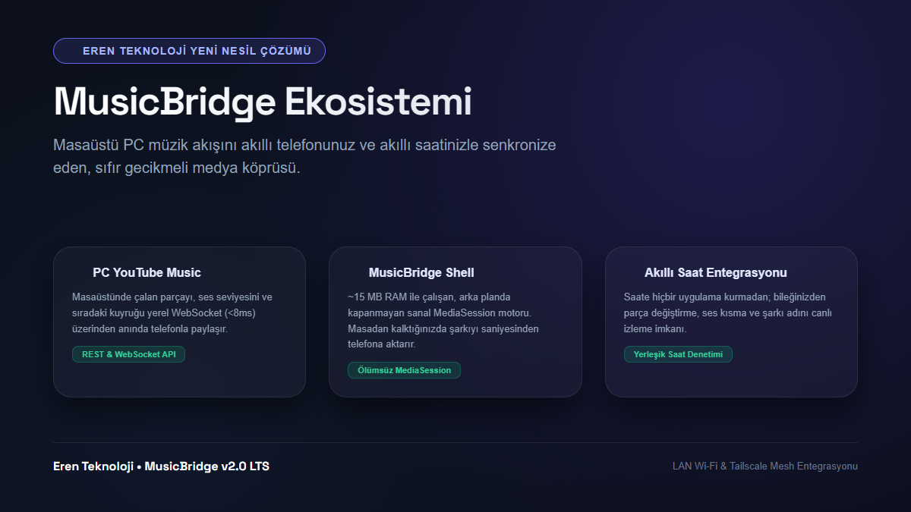
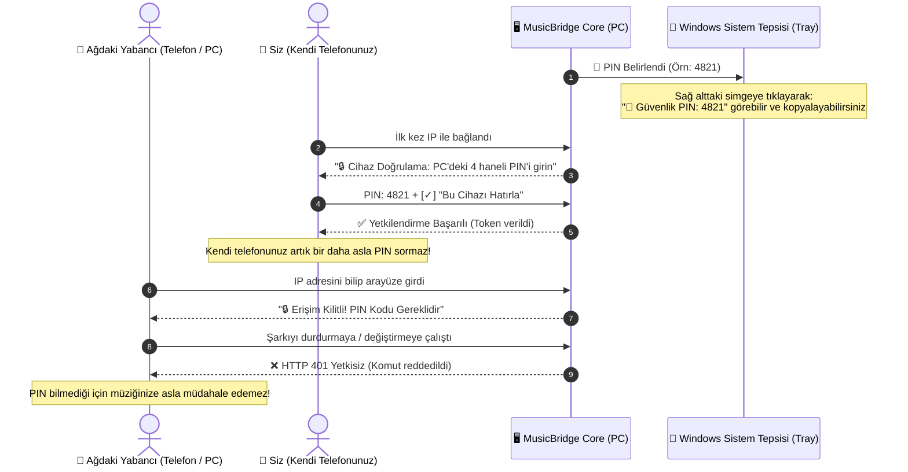
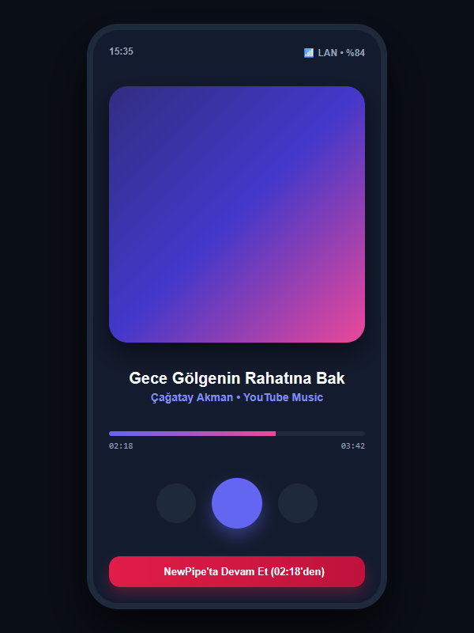
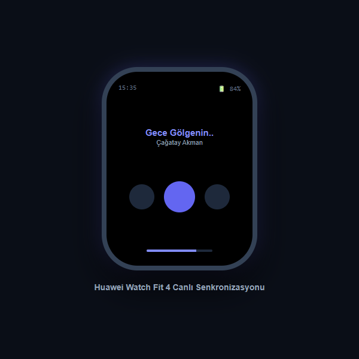
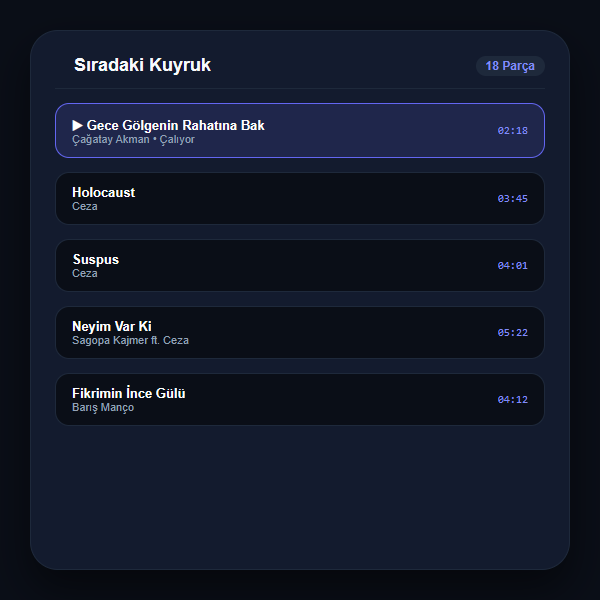
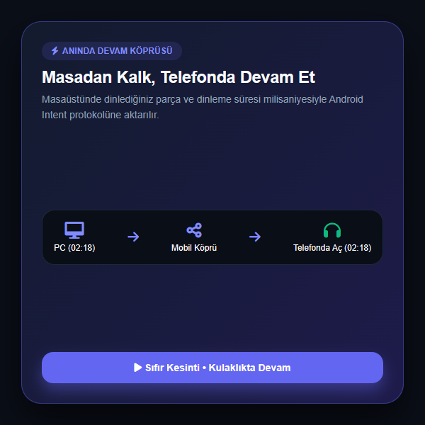

<div align="center">

# 🎵 MusicBridge

### *Akıllı Müzik Köprüsü • Akıllı Saat Entegrasyonu • Kesintisiz Mobil Aktarım*

<p align="center">
  
  
  
  
  
  <a href="https://linktr.ee/erennkun" target="_blank"></a>
</p>
<p align="center">
  <b>Masaüstü bilgisayarınızda çalan YouTube Music, YouTube Çalma Listeleri ve web ortam seslerini akıllı telefonunuzdan ve akıllı saatinizden sıfır gecikmeyle yönetin; masadan kalktığınızda tek tıkla telefonda kaldığı saniyeden dinlemeye devam edin.</b>
</p>

<p align="center">
  
</p>

---

</div>

## 💡 Genel Bakış

**MusicBridge**, masaüstü müzik deneyimi ile mobil ekosistem arasındaki kopukluğu ortadan kaldıran yeni nesil bir medya köprüsüdür.

Geleneksel uzaktan kumanda araçlarının aksine, **saatinize harici hiçbir uygulama veya mod yüklemenize gerek kalmaz.** Android'in yerel `MediaSession` mimarisini kullanarak telefonunuzun kilit ekranını ve akıllı saatinizin (tüm akıllı saatler, bileklikler veya standart Bluetooth kulaklıklar) yerleşik medya denetleyicisini doğrudan PC'ye bağlar.

```
┌─────────────────────────────────┐           Yerel Wi-Fi / Tailscale Mesh          ┌──────────────────────────────────┐
│         🖥️ WINDOWS PC           │ ◄─────────────────────────────────────────────► │       📱 ANDROID TELEFON         │
│  • YouTube Music / Web Player   │            Çift Yönlü WebSocket                 │  • MusicBridge Micro-Shell       │
│  • PC-Core Sunucusu (:8765)     │                 (< 8ms)                         │  • Virtual MediaSession Engine   │
└─────────────────────────────────┘                                                 └────────────────┬─────────────────┘
                                                                                                     │ 
                                                                    ┌────────────────────────────────┴────────────────┐
                                                                    │ Bluetooth                                       │ Android Intent
                                                                    ▼                                                 ▼
                                                     ┌──────────────────────────────┐                  ┌──────────────────────────────┐
                                                     │    ⌚ AKILLI SAAT            │                  │    🎧 MOBİL OYNATICI         │
                                                     │ • Tüm Akıllı Saat Modelleri  │                  │ • PC'deki saniyeden başlar   │
                                                     │ • Yerleşik Müzik Denetimi    │                  │ • Sıfır kayıp, anında devam  │
                                                     └──────────────────────────────┘                  └──────────────────────────────┘
```

---

## ✨ Öne Çıkan Özellikler

* ⌚ **Sıfır Kurulumlu Saat Kontrolü:** Saatinize ek uygulama kurmadan; Play, Pause, Sonraki Parça ve PC Sistem Sesini doğrudan bileğinizden yönetin.
* 🔄 **Telefonda Anında Devam:** Bilgisayar başından ayrılırken tek tıkla şarkıyı telefonunuzda **kaldığı saniyeden** (örn: `02:18`) kulaklığınızda başlatın.
* 🎤 **Akıllı Şarkı Sözleri (YouTube Music & Musixmatch Lisanslı DOM + Canlı Senkron):** Türk halk müziğinden türkülere ve popüler şarkılara kadar YouTube Music'in sağladığı zengin söz kütüphanesini ve LRCLIB canlı senkronunu anında telefona taşır. Özel söz arama desteği mevcuttur.
* 📋 **Akıllı Kuyruk & YouTube.com Playlist Desteği:** Hem `music.youtube.com` hem de standart `youtube.com` çalma listeleri ve Mix'lerini otomatik yakalar. Şarkıya tıklayınca anında geçer; **"Sıradaki Yap"** butonuyla mevcut şarkı bitince devam edilecek parçayı belirler.
* 🛡️ **Sıfır-Güven PIN Güvenliği:** Ortak Wi-Fi (yurt, ofis, ev) ağlarında yabancıların bilgisayarınızdaki müziği durdurmasını engeller; güvenli cihazları tek dokunuşla hatırlar.
* 🌐 **Tailscale & Uzaktan Erişim:** Sadece ev Wi-Fi ağında değil; Tailscale Mesh entegrasyonu sayesinde mobil veride (4.5G) sokaktayken dahi bilgisayarınızdaki müziği yönetin.
* 💻 **Otomatik Sistem Tepsisi (Tray) & Akıllı Port Yönetimi:** Windows başlangıcında simge kesinlikle tepsiye yerleşir. 8765 portu meşgulse çökmeden bir sonraki boş porta otomatik atlar.
* 🪶 **Ultra Hafif Mimari:** Ağır arayüz motorları barındırmaz. Arka planda yalnızca **~15 MB RAM** tüketir; pili sömürmez, eski ve yeni tüm Android cihazlarda (Android 8.0 - 15+) yağ gibi akar.

---

## 🔒 Güvenlik & Gizlilik Mimarisi (Zero-Trust Local Control)

Eren Teknoloji olarak kişisel gizliliğe ve yerel ağ güvenliğine en üst düzeyde önem veriyoruz. Ortak ev ağlarında, öğrenci yurtlarında veya ofis ortamlarında aynı Wi-Fi'ye bağlı başka birinin tarayıcıdan bilgisayarınızın yerel IP'sini girerek **izniniz dışında müziğinizi yönetmesini tamamen engelledik.**

### 🛡️ 4 Haneli Eşleştirme PIN'i ve Aygıt Doğrulama Akışı



### Güvenlik Prensiplerimiz:
1. **PIN Bilgisayardan Nasıl Öğrenilir?**
   - Windows görev çubuğunun sağ altındaki **MusicBridge tepsisi simgesine** sağ tıklayarak en üstteki **"🔑 Güvenlik PIN: XXXX"** alanından tek tıkla görebilir ve kopyalayabilirsiniz.
   - Bilgisayarın kendi tarayıcısından (`localhost:8765`) girildiğinde sistem sizi doğrudan tanır ve PIN sormaz; "Bağlantı" sekmesinde PIN her zaman okunabilir.
   - Dilerseniz `config.json` dosyasından sabit bir PIN kodu tanımlayabilirsiniz.
2. **Akıllı Cihaz Hafızası ("Bu Cihazı Hatırla"):**
   - Kendi telefonunuzdan veya tabletinizden PIN kodunu bir kez girdikten sonra cihazınız güvenli şifrelenmiş jeton (token) ile kaydedilir. Bir daha asla PIN sormaz.
3. **Bulutsuz & Sıfır İzleme:**
   - Şarkı geçmişiniz, dinleme alışkanlıklarınız veya donanım verileriniz hiçbir harici sunucuya veya buluta gönderilmez.
   - Tüm iletişim yerel Wi-Fi ağınızda veya uçtan uca şifreli Tailscale WireGuard tünelinizde gerçekleşir.

---

## ⚡ Karşılaştırma Tablosu

| Özellik | Klasik Uzaktan Kumandalar | KDE Connect / Unified | 🎵 MusicBridge |
|:---|:---:|:---:|:---:|
| **Saate Ek Uygulama Gerekir Mi?** | Evet | Evet | ❌ **Gerekmez (Yerel Destek)** |
| **Telefona Saniyesinden Aktarma** | ❌ Yok | ❌ Yok | ✅ **Tek Tıkla Doğrudan** |
| **Ağ İçi Yetkisiz Erişim Koruması** | ❌ Yok | ⚠️ Kısıtlı | 🛡️ **Zero-Trust PIN Sistemi** |
| **YouTube Music Söz Senkronu** | ❌ Yok | ❌ Yok | 🎤 **Musixmatch & LRCLIB** |
| **YouTube.com Playlist & Kuyruk** | ❌ Yok | ❌ Yok | 📋 **Anında Çalma & Sırada Çal** |
| **RAM Tüketimi** | ~60-120 MB | ~50-80 MB | 🚀 **~15 MB (Ultra Hafif)** |
| **Tailscale / Ev Dışı Erişim** | Karmaşık Port Ayarı | Kısıtlı | 🌐 **Doğal Destek** |
| **Arka Planda Kapanma Riski** | Yüksek | Orta | 🛡️ **Sıfır (Foreground Service)** |

---

## 🚀 Hızlı Başlatma ve Kullanım Seçenekleri

### 1. Bilgisayarda Başlatma (Windows)
`PC-Core` klasöründe ihtiyacınıza göre çalıştırma seçenekleri mevcuttur:

* **Sessiz Arka Plan & Sistem Tepsisi (Önerilen):**
  * **`MusicBridge-ArkaPlanda-Baslat.vbs`** dosyasına çift tıklayın. Konsol açılmadan doğrudan arka planda çalışır ve sistem tepsisine simgesi yerleşir.
* **Windows Başlangıçta Otomatik Başlatma:**
  * **`Baslangicta-Calistir-Kur.bat`** dosyasına çift tıklayın veya Web Arayüzündeki "Windows Başlangıçta Çalıştır" anahtarını açın. Bilgisayarınız her açıldığında arka planda otomatik başlar ve tepsiden anında erişilebilir.
* **Bildirim Alanı (System Tray):**
  * **`MusicBridge-Tray.vbs`** dosyasına çift tıklayın. Görev çubuğunun sağ altındaki sistem tepsisinde simge belirir; sağ tıklayarak PIN kodunu görebilir, web arayüzünü açabilir, IP kopyalayabilir ve sunucuyu kapatabilirsiniz.
* **Geliştirici Konsolu (Canlı Loglar):**
  * **`start.bat`** ile canlı konsol çıktısıyla başlatabilirsiniz.
* **Durdurmak İçin:**
  * **`MusicBridge-Durdur.bat`** dosyasını çalıştırarak tüm arka plan süreçlerini anında kapatabilirsiniz.

### 2. Telefonda Kullanım

1. Telefonunuzun tarayıcısından veya **MusicBridge Android** uygulamasından PC'nin adresine bağlanın (`http://192.168.1.x:8765` veya Tailscale `100.x.x.x:8765`).
2. İlk girişte bilgisayar ekranınızda / sistem tepsisinde görünen **4 haneli PIN kodunu** girin ve "Bu Cihazı Hatırla" kutucuğunu işaretleyin.
3. Masadan kalktığınızda **"Telefonda Aç"** butonuna dokunarak kaldığı saniyeden dinlemeye devam edin.

---

## ⌚ Akıllı Saat ile Kullanım

1. Telefonunuzda uygulamayı başlatıp PC'ye bağlayın.
2. Telefonunuzun ekranını kapatıp cebinize koyun.
3. Akıllı saatinizdeki yerleşik **Müzik** ekranını / widget'ını açın:
   * Şarkı adı ve sanatçı saat ekranında anlık görünür.
   * Play / Pause / Sonraki Parça kontrolleri milisaniyeler içinde PC'yi tetikler.
   * Saatin ses tuşları PC'nin sistem sesini açıp kısar.

---

## 📱 Uygulama Ekran Görüntüleri

<div align="center">

| Mobil Oynatıcı | Akıllı Saat Senkronu | Canlı Kuyruk | Telefona Aktarım |
|:---:|:---:|:---:|:---:|
|  |  |  |  |

</div>

---

## 🔗 İletişim & Ekosistem

<div align="center">

<a href="https://linktr.ee/erennkun" target="_blank">
  
</a>
<a href="https://github.com/ErenKun" target="_blank">
  
</a>

<br/><br/>

Geliştirici: [**Eren Teknoloji**](https://linktr.ee/erennkun) • Açık Kaynaklı Özgür Yazılım © 2026

</div>
