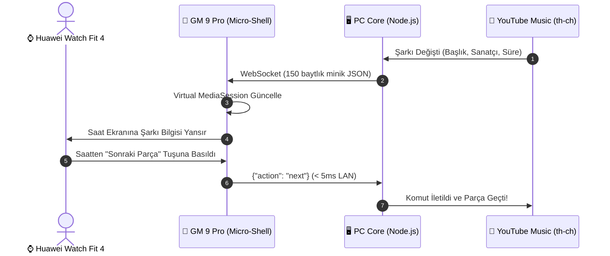

<div align="center">

# 🎵 MusicBridge

### *PC Medya Kontrolü • Huawei Watch Fit 4 Entegrasyonu • NewPipe Kaldığı Yerden Devam*

<p align="center">
  
  
  
  
  
</p>

<p align="center">
  <b>Masaüstü bilgisayarınızda çalan YouTube Music ve ortam seslerini telefonunuzdan ve Huawei Watch Fit 4 saatinizden sıfır gecikmeyle yönetin; tek tıkla NewPipe'ta saniyesinden devam ettirin!</b>
</p>

---

</div>

## 🌟 Neden MusicBridge?

Klasik uzaktan kumanda araçlarının aksine MusicBridge, **Huawei Watch Fit 4** gibi akıllı saatlerin yerleşik müzik denetleyicisini telefondaki yerel `MediaSession` köprüsüyle doğrudan PC'ye bağlar. Saate uygulama yüklemenize gerek kalmaz, telefonunuzun ekranı kapalıyken bile kesintisiz çalışır.

```
┌─────────────────┐       Wi-Fi / Tailscale       ┌──────────────────────┐
│  🖥️ WINDOWS PC  │ ◄───────────────────────────► │  📱 ANDROID TELEFON  │
│  YouTube Music  │          WebSocket            │  MusicBridge Shell   │
└─────────────────┘                               └──────────┬───────────┘
                                                             │ Bluetooth
                                                             ▼
                                                  ┌──────────────────────┐
                                                  │ ⌚ HUAWEI WATCH FIT 4│
                                                  │  Yerleşik Kontrol    │
                                                  └──────────────────────┘
```

---

## ✨ Temel Özellikler

| Özellik | Açıklama |
|:---|:---|
| ⌚ **Huawei Saat Uyumu** | Saate hiçbir şey kurmadan; Play, Pause, Sonraki Parça ve Ses seviyesini bileğinizden yönetin. |
| 🔄 **NewPipe Anında Devam** | Masadan kalktığınızda şarkıyı telefonunuzdaki NewPipe uygulamasında **kaldığı saniyeden** (örn: 02:18) başlatın. |
| 🌐 **Tailscale Desteği** | Ev Wi-Fi ağının dışındayken veya mobil veride (4.5G) sokaktayken dahi PC'deki müziğe erişin. |
| 🪶 **Ultra Hafif (~15 MB RAM)** | GM 9 Pro (Android 9) ve eski cihazlar için özel optimize edilmiştir; pili tüketmez, arka planda kapanmaz. |
| 📋 **Kuyruk Senkronizasyonu** | PC'de sıradaki parçaları anlık olarak listeleyin ve tek dokunuşla parça seçin. |
| 🛠️ **Sıfır APK Kur-Sil Döngüsü** | Arayüz PC sunucusundan anlık olarak çekilir; PC'de yapılan arayüz değişiklikleri telefonda F5 ile yenilenir. |

---

## 🏗️ Mimari ve Nasıl Çalışır?



---

## 🚀 Kurulum ve Başlangıç

### 1. PC Tarafı (Windows)
1. `PC-Core/` dizinindeki **`start.bat`** dosyasına çift tıklayın.
2. Ekranda yerel IP adresiniz görünecektir:
   ```text
   📡 Yerel Ağ (Ev Wi-Fi) Adresi  : http://192.168.1.42:8765
   🌐 Tailscale Adresi           : http://100.85.12.34:8765 (Varsa)
   ```

### 2. Telefon Tarafı (Android)
1. Bu GitHub deposunun **Actions** sekmesinden derlenen hazır **`MusicBridge.apk`** dosyasını indirin ve GM 9 Pro telefonunuza kurun.
2. Uygulamayı ilk açtığınızda bilgisayarınızın ekranda yazan IP adresini girip **Bağlan** deyin.
3. Artık telefonun ekranı kilitli olsa bile Huawei saatinizdeki "Müzik" menüsünden PC'deki şarkıyı kontrol edebilirsiniz!

---

## 📱 Ekran Görüntüleri ve Arayüz

<div align="center">

| 1. Çalar Ekranı | 2. Sıradaki Kuyruk | 3. NewPipe Devam |
|:---:|:---:|:---:|
| 🎵 Canlı Albüm Kapağı & Ses Slider | 📋 PC'deki Çalma Listesi | 🚀 Tek Tıkla Saniyesinden Devam |

</div>

---

## 🔒 Güvenlik & Gizlilik

* **Dış Bulut Yok:** Verileriniz hiçbir yabancı sunucuya gitmez, yalnızca evinizdeki yerel ağ ve şifreli Tailscale tüneli üzerinde dolaşır.
* **Gereksiz İzin Yok:** Konum, kamera, mikrofon veya rehber izni kesinlikle talep edilmez.

---

<div align="center">

<sub>Geliştirici: <b>Eren Teknoloji</b> • Tüm Hakları Saklıdır © 2026</sub>

</div>
